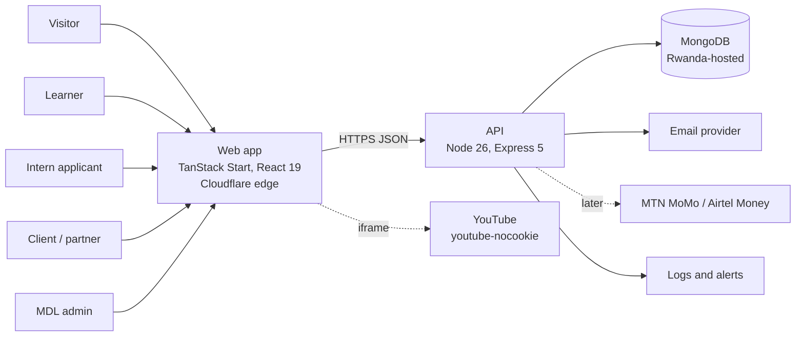
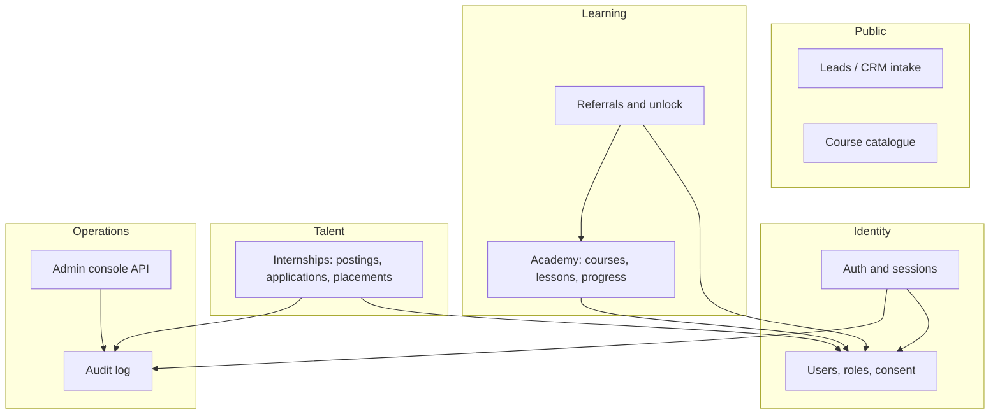
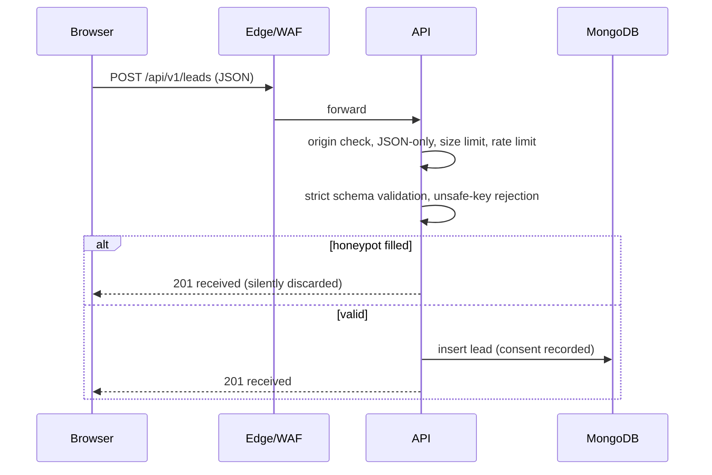

# 02 — High-Level Design (HLD)

> Status: **Draft v0.1** · 2026-11-13 · Inputs: `01-research-and-gap-analysis.md`
> Scope: the MDL company platform (public site, learner/intern portal, admin console, API).

## 1. Goals and non-goals

**Goals (MVP, in priority order)**

1. A fast, professional public site that is honest about what MDL offers today.
2. Lead capture that actually works (contact, service request, partner, corporate, internship interest).
3. A free **Academy**: courses built from YouTube videos, embedded professionally, with progress tracking.
4. A **verified-referral unlock** so free training spreads and MDL gains early recognition.
5. An **internship pipeline**: postings, applications, review, supervisor assignment, guardian consent.
6. An **admin console** with audit logging so the two founders can run all of the above safely.

**Non-goals for MVP** (documented so they are not built by accident): paid products and checkout, native
mobile apps, live video, chat, a marketplace, automated certificate issuance beyond a verifiable page,
multi-tenant institutional portals.

## 2. Constraints that shape the design

| Constraint | Source | Design response |
|---|---|---|
| Few smartphones, expensive data | ILO diagnostic | Lean pages, lazy video, no autoplay, SSR for first paint |
| Personal data must be stored in Rwanda (or authorised abroad) | Law 058/2021 | Rwanda-hosted database for PII; configurable DB URL (ADR-0003) |
| Under-16 users need guardian consent | Law 058/2021 | Age gate and guardian-consent flow from day one |
| Two founders, part-time, small budget | Brief | One repo, boring tech, managed where lawful, strong CI instead of process |
| Existing Lovable-synced frontend | Repo | Keep it at the repo root; add `backend/` and `docs/` beside it (ADR-0001) |
| MERN requested | Brief | Mongo, Express 5, React 19 (TanStack Start), Node 26 LTS; TypeScript everywhere |

## 3. System context



## 4. Containers and responsibilities

| Container | Tech | Responsibility | Never does |
|---|---|---|---|
| Web app | TanStack Start, React 19, Tailwind, shadcn/ui | Rendering, SEO, forms, learner dashboard, admin UI | Holds secrets; trusts its own validation |
| API | Node 26, Express 5, TypeScript, Zod, Mongoose | All business rules, auth, validation, authorisation, audit | Serves HTML; stores secrets in code |
| Database | MongoDB 8 replica set | System of record | Is reachable from the internet |
| Email | Transactional provider (to select, see open items) | Verification, reset, notifications | Sends marketing without consent |
| Video | YouTube (unlisted videos, privacy-enhanced embeds) | Hosting and streaming | Enforces access control |
| CDN/WAF | Cloudflare | TLS, caching, bot and DDoS filtering | Replaces app-level authorisation |

## 5. Bounded contexts (backend modules)



Each module owns its collections and exposes a service interface. Modules talk through services, never
through each other's models. This keeps a later split into separate services possible without a rewrite.

## 6. Key flows

### 6.1 Lead submission (Sprint 0/1, first working slice)



The response never reveals whether an email already exists, and never returns the stored record.

### 6.2 Referral unlock (Sprint 3)

```mermaid
sequenceDiagram
  participant L as Learner
  participant A as API
  participant F as Friend
  L->>A: GET my referral link
  A-->>L: /r/CODE (unique, unguessable)
  L->>F: shares via WhatsApp, LinkedIn, X, FB, IG
  F->>A: opens /r/CODE (attribution cookie)
  F->>A: registers and verifies email/phone
  A->>A: anti-abuse checks, count distinct verified invitees
  A-->>L: progress n of N; unlock when N reached
```

### 6.3 Video access (Sprint 2)

The lesson API returns the YouTube video ID **only** to an enrolled, unlocked learner. The client renders a
thumbnail facade and loads the `youtube-nocookie.com` iframe on tap. The referrer policy keeps a referrer
(YouTube returns error 153 without one). Gating is a growth mechanic, not content protection (ADR-0005).

### 6.4 Internship application (Sprint 4)

Applicant registers → completes profile → age check (guardian consent if under 16) → applies to a posting →
admin reviews → interview → supervisor assigned → agreement recorded → placement. The UI states plainly that
applying does not guarantee a place, matching the proposal.

## 7. Cross-cutting design

- **Security:** layered, assume-breach. Full model in `04-security-and-threat-model.md`.
- **Privacy:** data minimisation, purpose-bound consent, retention limits, export and delete.
- **Observability:** structured JSON logs with request IDs, PII redaction, health and readiness endpoints,
  uptime and error alerts.
- **Configuration:** all via environment variables, validated at start-up, process refuses to boot on bad config.
- **Accessibility and i18n:** WCAG 2.2 AA target; English first, Kinyarwanda in Sprint 6.
- **Performance budget (public pages):** first load under about 200 KB of JS, largest contentful paint under
  2.5 s on a throttled 3G profile. Enforced in CI from Sprint 5.

## 8. Deployment topology

| Environment | Frontend | API and DB | Data allowed |
|---|---|---|---|
| Local | `bun dev` | `docker compose` Mongo bound to localhost | Synthetic only |
| Staging | Cloudflare preview | Small VM or container, non-production DB | Synthetic only, never real PII |
| Production | Cloudflare | Rwanda-hosted VMs or containers; MongoDB replica set in Rwanda | Real data |

Recommended hosting for production (to confirm on price and SLA): a Rwanda IaaS provider such as TrAC's
My.cloud, with MongoDB self-managed as a three-node replica set, TLS, encrypted volumes and tested backups.
Atlas Cape Town may be used **only** for non-personal data unless NCSA authorisation is obtained.

## 9. Technology choices (summary)

| Concern | Choice | Why |
|---|---|---|
| Language | TypeScript (strict) end to end | One language for the team, fewer runtime bugs |
| API framework | Express 5 | Familiar, stable, async error handling built in |
| Validation | Zod, strict schemas | Rejects unknown fields; one source of truth for types |
| ODM | Mongoose 9 | Schema-level constraints on top of Zod |
| Auth | Server-side sessions in httpOnly cookies (ADR-0004) | Revocable; no tokens in browser storage |
| Passwords | argon2id (Sprint 1) | Modern memory-hard hash |
| Logging | pino | Fast, structured, supports redaction |
| Tests | Vitest and Supertest | Same runner as the frontend |
| CI | GitHub Actions, SHA-pinned | Supply-chain hardening |

## 10. Top risks

| Risk | Likelihood | Impact | Mitigation |
|---|---|---|---|
| Unlawful storage of personal data outside Rwanda | Medium | High | ADR-0003; launch gate in the sprint plan |
| Referral gate is gamed or too steep | High | Medium | Verified signups only, anti-abuse, configurable threshold, A/B test |
| Interns or partners over-promised (reputation, legal) | Medium | High | "No guarantee" wording, supervisor required before acceptance |
| Two-person bus factor | High | High | Docs in repo, CI as safety net, secrets in a manager, shared access to all accounts |
| Scope creep across four pillars | High | High | Sprint plan stages; non-goals list; "decline work we cannot deliver" rule |
| Supply-chain compromise via npm or Actions | Medium | High | Lockfiles, `npm ci`, SHA-pinned Actions, Dependabot with cooldown, audit in CI |

## 11. Decision log

See `docs/adr/`: 0001 repo layout, 0002 referral unlock, 0003 data residency and hosting, 0004 session
auth, 0005 YouTube delivery and soft gating, 0006 Node and toolchain versions.
